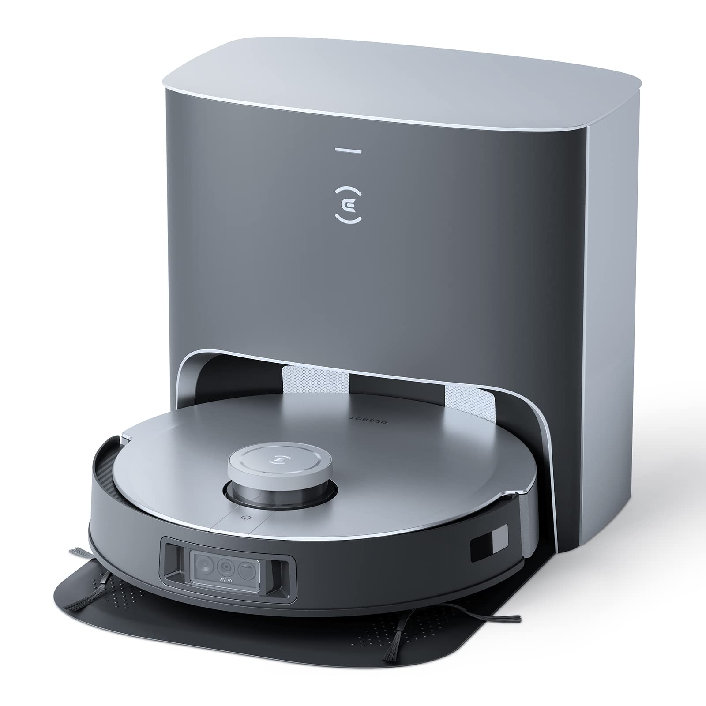

  
  &nbsp;&nbsp;&nbsp;&nbsp;
  
  
<em>Reverse-engineering notes behind local, cloud-free control of the Ecovacs Deebot X1</em>

# Ecovacs Deebot X1, Local Control Research

This is the research companion to a working Valetudo fork that runs the Ecovacs Deebot X1 Omni
fully local, with no Ecovacs cloud and no account. It holds the reverse-engineering that made
the fork possible: the map format, the robot's on-board ROS interface, the control and settings
protocols, and the on-device deployment. The fork itself lives in a [separate repository](https://github.com/GrahamKowalski/valetudo-ecovacs-x1).

> **Status: the core work is done and running on a real X1 Omni.** State, map, cleaning
> control, fan and water, locate, and the Home Assistant integration are implemented and
> verified on device. This repo documents how, and tracks the remaining gaps. Root and unlock
> for the X1 were already public; the contribution here is the local-control layer.

## The two layers

Getting an X1 off the cloud has two independent layers, at very different maturity:

| Layer | What it is | Maturity |
|---|---|---|
| **1. Root / unlock** | UART console, serial-derived root password, firmware dump, persistent shell | **Mature**, public since 2022, documented by itsjfx / Dennis Giese |
| **2. Local-control app** | Valetudo running on-device, exposing real capabilities (map, cleaning, zones, settings) over MQTT to Home Assistant | **Working**, built in this effort; state, map, control, fan/water, and HA integration run on device |

Layer 1 is a prerequisite we follow existing guides for and do not re-derive. Layer 2 is the
work documented here.

## What is in this repo

- **research/** the findings: the map format, the live state stream, the control findings,
  settings coverage, deployment and persistence notes, and the handoff doc.
- **research/x1-ros-defs/** the robot's ROS message definitions, captured from the device's own
  publishers.
- **scripts/** pure-stdlib tooling to read, call services on, and publish to the robot's ROS
  graph reflash-free: subscribe, service-call, publish, map request, u-boot helpers.
- **deploy/** the rootfs build, the kernel-4.14 madvise patch, `rc.local`, the config seed, and
  the RUNBOOK for building and flashing the backend.
- **docs/** hardware, the local interface, architecture, the capability matrix, and licensing.

## What is known (confirmed)

- **SoC:** Horizon Robotics X3M (4x Cortex-A53 + Cortex-R5 + BPU), aarch64. Linux 4.14.74 + ROS,
  U-Boot. Secondary Baidu DU1906 voice DSP with its own SPI flash.
- **Storage:** raw SPI-NAND, 512 MB, UBI/UBIFS + squashfs rootfs. **RAM:** 1 GB.
- **UART console:** `ttyS0,115200`, **3.3 V**, GND nearest the micro-USB port. A 5 V adapter can
  damage the front end.
- **Root:** per-device password derived from the 20-char serial number. Rootfs is read-only
  squashfs; persistent changes need a patched reflash of the UBI volume.
- **Variants:** X1 Plus / Omni / Turbo differ only in mop and dock; the compute board and root
  path are the same (Plus / Turbo not separately verified, see open questions).

See [docs/hardware.md](docs/hardware.md) for sources and evidence levels.

## Where to start

- [Research status and evidence levels](STATUS.md)
- [Capability matrix / roadmap](docs/capability-matrix.md)
- [The robot's local protocol](docs/local-interface.md)
- [Deployment runbook](deploy/RUNBOOK.md)
- [Open questions](research/open-questions.md)
- [Sources and attribution](references/sources.md)
- [How to contribute (evidence labels + redaction rules)](CONTRIBUTING.md)

## Scope and safety

Research notes and non-destructive analysis only. **No firmware dumps, no device serial numbers,
no root passwords, no SYSINFO secrets, no account tokens** in this repo; the serial number alone
is the root credential seed. See [CONTRIBUTING.md](CONTRIBUTING.md) and [.gitignore](.gitignore).
Do not take an OTA update on a device you intend to root; newer firmware can close the path.

## License

Original research documentation and scripts here are MIT (see [LICENSE](LICENSE)). Third-party
works (Valetudo, ValetudoEV, itsjfx/ecovacs-hacking, Dennis Giese's research) remain under their
own licenses and with their authors. The Valetudo logo above is from the Valetudo project
(Apache-2.0).
