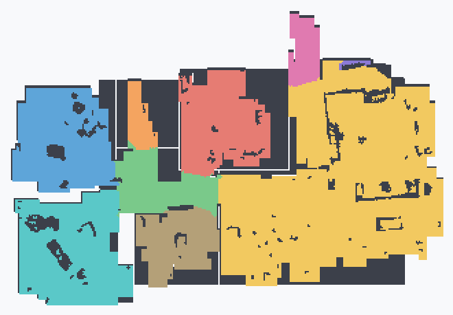

# X1 map format, decoded (2026-10-25)

**observed** on the owned X1 Plus. The map grid is fully decoded from a real captured
payload, the single highest-value unknown in the project (open question 8) is resolved.



*Decoded live from the robot: an 800×800 occupancy grid, rendered with one colour per
room segment. No coordinates/identifiers are in the image.*

## How it was captured (reflash-free)

1. Root over UART, then start a network shell: `telnetd -l /bin/sh -p 2323` (busybox
   has `telnetd`). This frees the robot from the serial tether so it can drive and map.
2. On the robot, capture loopback IPC while it runs a short clean, excluding the big
   camera/video streams:
   `tcpdump -i lo -s0 -w /tmp/map.pcap 'not port <video ports>'`, pull via `nc`.
3. The map crosses `127.0.0.1` in plaintext as **ROS TCPROS**. The map is served by the
   ROS node (port 39717) as the service **`map/ManipulateShowMap`**
   (`request_type=map/ManipulateShowMapRequest`, `response_type=…Response`,
   md5sum `dd59271fa637da4341446b548bbb38cd`).

## Payload format (map/CompressMap)

Both map services return a `map/CompressMap` message (response = `uint8 result`, then the
CompressMap). Structure:

- `uint32 mapid`
- `MapMetaInfo info` = 7 x uint16: `mapWidth`, `mapHeight`, `cols`, `rows`, `submapWidth`,
  `submapHeight`, `resolution` (mm per cell; 50 = 5 cm, the Valetudo pixel size)
- `CompressSubMap[] submaps` = `uint32 count`, then per submap: `uint16 submapid`,
  `uint32 crc32`, `uint32 length`, `int8[] data` (`uint32` byte count, then the bytes)

The grid is **tiled**: `cols` x `rows` submaps of `submapWidth` x `submapHeight`, in
row-major order, assembled into the full `mapWidth` x `mapHeight` grid. `ManipulateShowMap`
returned a single 800x800 tile; `GetCurrentCompressMap` returns 8x8 tiles of 100x100.

Each submap's `data` is an **LZMA1 "alone" stream with an Ecovacs truncated 8-byte header**
(same compression as the cloud map pieces in `DeebotUniverse/client.py`). Reinsert four
zero bytes after byte 8, then decode:
```python
import lzma
stream = blob[:8] + b"\x00\x00\x00\x00" + blob[8:]
tile = lzma.decompress(stream, format=lzma.FORMAT_ALONE)   # submapWidth*submapHeight bytes
```
The stream begins at the LZMA props byte `0x5d` (`lc=3, lp=0, pb=2`), one byte per cell.

## Live acquisition (reflash-free, confirmed)

The map can be fetched on demand with **root only, no reflash**, by calling the ROS service
**`/map/GetCurrentCompressMap`** (request `uint8 type=0`, `uint32 mapid=0`) over raw TCPROS
from a pure-Python stdlib client (no rospy, which is incomplete on the device). Steps:

1. `telnetd -l /bin/sh -p 2323` over UART for a network shell (survives the robot roaming).
2. XMLRPC `lookupService` to the master at `http://127.0.0.1:11311`, connect TCPROS, send a
   connection header with `md5sum=*` (the generated `.py` md5s are stale vs the running node;
   the wildcard skips the check), send the request, read `[ok][len][payload]`.
3. The `payload` is the `GetCurrentCompressMapResponse`, parsed by `EcovacsMapParser` in the
   fork into a `ValetudoMap`.

`GetCurrentCompressMap` needs no map id; `ManipulateShowMap` requires a valid `mapid` and
returns `ok=0` otherwise. A live fetch decoded and rendered correctly end to end.

## Metadata (pre-grid bytes 0..36)

The response starts with a small fixed header before the compressed blob:

| Offset | Bytes | Value | Meaning |
|---|---|---|---|
| 5, 7 | int16 x2 | 800, 800 | map width, height (cells) |
| 13, 15 | int16 x2 | 800, 800 | second w/h pair (full map extent) |
| 17 | int16 | 50 | **pixel size, 50 mm/cell** (800 cells ~= 40 m span) |
| 33 | int32 | 2708 | length of the LZMA blob that follows |

## Cell encoding

Confirmed by rendering each value separately (see diagnostic render):

| Value | Count | Meaning |
|---|---|---|
| `0` | 592,834 | unexplored / background |
| `101`-`109` | ~2k-17k each | **floor, segmented into rooms** (each value a room) |
| `2` | ~700 | **wall** (traces the outer perimeter) |
| `5` | ~2,300 | **obstacle / furniture** (outlines inside rooms) |
| `4` | ~6,700 | floor scanned but **not yet assigned to a room** (capture was mid-clean) |
| `1` | ~300 | negligible, unclassified |

Parser mapping: FLOOR = `{4, 101-109}`, WALL = `{2, 5}`, segments = `{101-109}`.

Still to capture: robot/charger pose (`getPos`/`onPos`, `map/ChargerDockInfo`) and the grid
origin for world coordinates. `ManipulateTrace` returned a 21-byte status (no path points) in
this capture. A capture while the robot docks/relocates should yield the pose.

## Implication for the fork

The map is obtainable from the **local ROS service with root only, no reflash, no cloud,
no TLS**. So the Valetudo robot impl can pull + LZMA-decode this grid directly, a cleaner
fully-local path than ValetudoEV's cloud (`onMajorMap`) emulation. The cloud format uses
the *same* LZMA compression, so a parser written here transfers.

Raw captures (`manipulateshowmap_response.bin`, the decoded grid, pcaps) are kept **out of
the repo** (device data / home layout). Only the rendered PNG above is committed.
